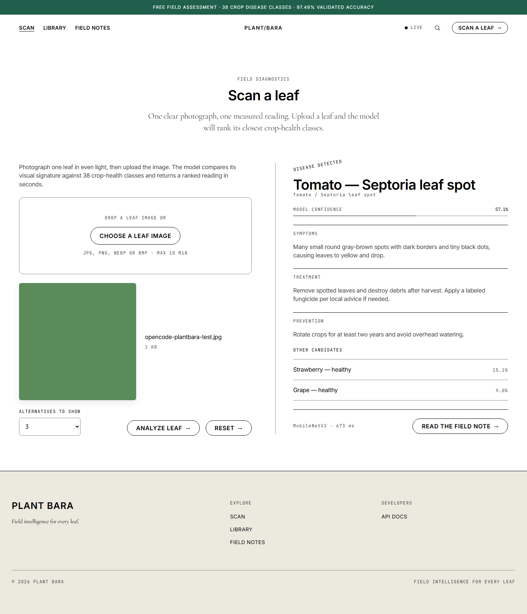

# Plant BARA

**Field intelligence for every leaf.**

Plant BARA is an end-to-end crop-disease detection system. A farmer photographs a leaf, a fine-tuned MobileNetV2 classifier identifies the likely disease among 38 PlantVillage classes, and the API returns plain-language symptoms, treatment and prevention guidance.

The repository contains a FastAPI/TensorFlow backend and a React/TypeScript frontend built around the editorial apothecary design system in [`design.md`](design.md).

- **Live API:** <https://plant-bara.onrender.com/>
- **Interactive API docs:** <https://plant-bara.onrender.com/docs>
- **Health check:** <https://plant-bara.onrender.com/api/v1/health>



## Contents

- [What it does](#what-it-does)
- [Architecture](#architecture)
- [Tech stack](#tech-stack)
- [Repository layout](#repository-layout)
- [Quick start](#quick-start)
- [Configuration](#configuration)
- [API reference](#api-reference)
- [Model](#model)
- [Frontend](#frontend)
- [Testing and QA](#testing-and-qa)
- [Status](#status)
- [Limitations](#limitations)
- [Documentation map](#documentation-map)
- [Credits](#credits)

## What it does

- Classifies leaf photos across **38 crop/disease classes** from the PlantVillage dataset.
- Returns up to `top_k` ranked candidates (1–38, default 3), with the top prediction enriched with disease guidance.
- Enriches each prediction with **symptoms, treatment and prevention** text from JSON artifacts — no database required.
- Validates uploads by MIME type, decoded image and size (maximum **10 MiB**; JPEG, PNG, WebP, BMP).
- Keeps serving if the model is unavailable: health reports `model_loaded: false` and prediction returns **503**.
- Provides a searchable disease library, responsive scan flow and field-note pages in the frontend.

## Architecture

```
Browser (React SPA)
   │  multipart image / JSON over HTTPS
   ▼
FastAPI  /api/v1
   ├── image validation + EXIF-aware decoding (Pillow)
   ├── ModelService   → MobileNetV2 (TensorFlow/Keras), top-k inference
   └── DiseaseService → phase1_artifacts/*.json lookups
```

The backend loads the Keras model once at startup. The frontend is a static SPA that talks to the API directly; there is no server-side rendering or database tier.

## Tech stack

| Layer | Technology |
| --- | --- |
| Backend | Python 3.10+, FastAPI, Uvicorn |
| ML | TensorFlow 2.21 / Keras, MobileNetV2, NumPy, Pillow |
| Validation | Pydantic v2, `python-multipart` |
| Tests | pytest, `fastapi.testclient` |
| Frontend | React 18.3, TypeScript 5.6, Vite 6, React Router 6 |
| Styling | Plain CSS with design tokens (no UI framework) |
| Data | JSON artifacts in `plant_backend/phase1_artifacts/` |

## Repository layout

```
Plant_bara/
├── plant_backend/
│   ├── app/
│   │   ├── main.py              # FastAPI app, CORS, startup model load
│   │   ├── config.py            # environment-driven settings
│   │   ├── schemas.py           # Pydantic response models
│   │   ├── api/routes.py        # /api/v1 endpoints
│   │   ├── services/            # model inference + disease lookup
│   │   └── utils/image.py       # upload validation and decoding
│   ├── tests/                   # hermetic pytest suite (faked services)
│   ├── phase1_artifacts/        # model, class list, disease info, metrics
│   ├── start.bat                # one-click Windows launcher
│   └── README.md                # detailed backend documentation
├── plant_frontend/
│   ├── src/                     # pages, components, hooks, API client, styles
│   ├── qa/                      # QA reports, capture scripts, screenshots
│   ├── dist/                    # production build output (generated)
│   └── README.md                # frontend run guide and routes
├── design.md                    # visual system and component rules
├── AGENTS.md                    # notes for AI coding agents
└── README.md                    # this file
```

## Quick start

### Prerequisites

- **Python 3.10+** for the backend.
- **Node.js 18+** (Vite 6 supports 18, 20 and 22+; npm included).
- Windows commands below use PowerShell. On macOS/Linux, activate the venv with `source .venv/bin/activate` and use `python -m ...`.

### 1. Backend

```powershell
cd plant_backend
python -m venv .venv
.\.venv\Scripts\python.exe -m pip install -r requirements.txt
.\.venv\Scripts\python.exe -m uvicorn app.main:app --reload --host 127.0.0.1 --port 8000
```

Allow **10–20 seconds** on first startup while the ~26 MB Keras model loads. Then open:

- Swagger UI: <http://127.0.0.1:8000/docs>
- Health check: <http://127.0.0.1:8000/api/v1/health>

On Windows you can also double-click **`plant_backend/start.bat`**. It creates the venv if needed, reinstalls dependencies only when `requirements.txt` changes, and starts Uvicorn on port 8000 without `--reload`.

If model loading fails, the API still starts; `/api/v1/predict` returns **503** until the model is available.

### 2. Frontend

```powershell
cd plant_frontend
npm install
npm run dev
```

Open <http://127.0.0.1:5173>.

The client defaults to the deployed API at `https://plant-bara.onrender.com/`. To use your local backend instead:

```powershell
cd plant_frontend
Copy-Item .env.example .env
```

Then set:

```dotenv
VITE_API_BASE_URL=http://127.0.0.1:8000/
```

There is no Vite proxy — the browser calls `VITE_API_BASE_URL` directly. The backend's default `CORS_ORIGINS=*` permits local development.

### 3. Production build

```powershell
cd plant_frontend
npm run build      # runs tsc --noEmit, then vite build
```

Deploy the contents of `plant_frontend/dist/` to any static host. Because the app uses client-side routes, configure a fallback that serves `index.html` for unknown paths.

## Configuration

Backend settings are environment variables read once at import by `plant_backend/app/config.py`. Copy `.env.example` to `.env` only if you need overrides; the defaults match the repository layout.

| Variable | Default | Purpose |
| --- | --- | --- |
| `MODEL_PATH` | `phase1_artifacts/best_model.keras` | Keras model loaded at startup |
| `CLASS_NAMES_PATH` | `phase1_artifacts/class_names.json` | Ordered 38-class label list |
| `DISEASE_INFO_PATH` | `phase1_artifacts/disease_info.json` | Symptoms, treatment, prevention data |
| `MODEL_META_PATH` | `phase1_artifacts/model_meta.json` | Architecture and accuracy metadata |
| `INPUT_SIZE` | `224x224` | Model input resolution |
| `MAX_UPLOAD_BYTES` | `10485760` | Upload limit (10 MiB) |
| `ALLOWED_CONTENT_TYPES` | `image/jpeg,image/png,image/webp,image/bmp` | Accepted MIME types |
| `CORS_ORIGINS` | `*` | Comma-separated allowed browser origins |
| `DEFAULT_TOP_K` | `3` | Predictions returned when `top_k` is omitted |
| `MAX_TOP_K` | `38` | Upper bound for `top_k` |

The `ml_dtypes==0.5.4` pin in `requirements.txt` is intentional: version 0.7.0's Windows DLL is blocked by Application Control on some machines.

Frontend configuration:

| Variable | Default | Purpose |
| --- | --- | --- |
| `VITE_API_BASE_URL` | `https://plant-bara.onrender.com/` | API root used by the browser client |

## API reference

Base path: `/api/v1` (except the root welcome endpoint).

| Method | Path | Description |
| --- | --- | --- |
| `GET` | `/` | Welcome message and links to docs/health |
| `GET` | `/api/v1/health` | Service status and `model_loaded` flag |
| `GET` | `/api/v1/model/info` | Architecture, input size, training metadata |
| `POST` | `/api/v1/predict?top_k=3` | Multipart image upload; returns top-k predictions |
| `GET` | `/api/v1/diseases` | All 38 classes with display names |
| `GET` | `/api/v1/diseases/{class_name}` | Detail for one class (e.g. `Tomato___Late_blight`) |

### Predict

```bash
curl -X POST "https://plant-bara.onrender.com/api/v1/predict?top_k=3" \
  -H "Accept: application/json" \
  -F "file=@leaf.jpg;type=image/jpeg"
```

On Windows PowerShell, use `curl.exe`; bare `curl` is an alias for `Invoke-WebRequest`.

Example response (trimmed):

```json
{
  "success": true,
  "prediction": {
    "class_name": "Tomato___Septoria_leaf_spot",
    "display_name": "Tomato — Septoria leaf spot",
    "crop": "Tomato",
    "disease": "Septoria leaf spot",
    "is_healthy": false,
    "confidence": 0.571,
    "symptoms": "…",
    "treatment": "…",
    "prevention": "…"
  },
  "alternatives": [
    {
      "class_name": "Strawberry___healthy",
      "display_name": "Strawberry — healthy",
      "confidence": 0.151
    }
  ],
  "model": {
    "name": "MobileNetV2",
    "architecture": "MobileNetV2",
    "input_size": [224, 224],
    "version": "1.0.0"
  },
  "processing_time_ms": 725.4
}
```

`confidence` values are probabilities in `[0, 1]`. The top prediction is `prediction`; remaining candidates are ordered by confidence in `alternatives`.

### Errors

| Status | Meaning |
| --- | --- |
| `400` | Empty, oversized or invalid image upload |
| `404` | Unknown disease class |
| `422` | Invalid `top_k` or malformed request |
| `503` | Model not loaded, or no predictions returned |
| `500` | Unexpected inference failure |

Error responses use FastAPI's standard `{"detail": "..."}` shape.

## Model

| Property | Value |
| --- | --- |
| Architecture | MobileNetV2 (fine-tuned) |
| Framework | TensorFlow/Keras 2.21.0 |
| Classes | 38 (`Crop___Disease`, e.g. `Tomato___Late_blight`) |
| Input | 224 × 224 RGB, `mobilenet_v2.preprocess_input` |
| Dataset | PlantVillage (color) |
| Test accuracy | **97.49%** |
| Validation accuracy | **97.49%** |
| Runtime artifact | `plant_backend/phase1_artifacts/best_model.keras` |

Class names, disease guidance, confusion matrices, per-class metrics and training history live in `plant_backend/phase1_artifacts/`. The API needs no database: `DiseaseService` loads the JSON artifacts at startup and exposes read-only lookups.

## Frontend

Routes:

| Route | Purpose |
| --- | --- |
| `/` | Hero, model stats, scan panel, method, featured diseases |
| `/scan` | Dedicated scan flow with ranked result and field note |
| `/diseases` | Searchable 38-class library with crop/health/text filters |
| `/diseases/:className` | Symptoms, treatment, prevention and related classes |
| `/about` | Field notes, method and live model metadata |
| `*` | 404 page |

The visual system comes from [`design.md`](design.md): parchment surfaces, obsidian ink, botanical photography, ghost pill buttons, and bronze reserved for the seal accent. There are no gradients or heavy card shadows. See [`plant_frontend/FRONTEND_PLAN.md`](plant_frontend/FRONTEND_PLAN.md) for the design rules and API contracts used during the build.

## Testing and QA

### Backend

```powershell
cd plant_backend
.\.venv\Scripts\python.exe -m pytest -q
```

The suite has 14 tests and runs in well under a second. It uses `TestClient` **without** its context manager, so the application lifespan never runs and the real TensorFlow model is never loaded. API tests replace model and disease services with deterministic fakes; disease-service tests exercise the real service against the JSON artifacts.

Run a single file or test:

```powershell
.\.venv\Scripts\python.exe -m pytest tests\test_predict.py -q
.\.venv\Scripts\python.exe -m pytest tests\test_predict.py -q -k success
```

### Frontend

```powershell
cd plant_frontend
npm run typecheck
npm run build
```

There is no lint or unit-test setup; TypeScript and the production build are the static gates.

### Browser QA

With the dev server running on `127.0.0.1:5173`:

```powershell
cd plant_frontend
node qa\capture-cdp.mjs      # six routes at 1440×900 and 390×844
node qa\e2e-predict.mjs      # uploads a real image through the UI
```

- `capture-cdp.mjs` uses Chrome DevTools Protocol for true mobile emulation and writes PNGs to `%TEMP%\plant-qa-cdp`.
- `e2e-predict.mjs` expects a leaf JPEG at `%TEMP%\opencode-plantbara-test.jpg` (place any leaf photo there) and calls the live backend.
- Both scripts hardcode Chrome at `C:/Program Files/Google/Chrome/Application/chrome.exe`; edit the constant if your installation differs.
- The QA scripts use Node's global `WebSocket`, so use **Node 22+** for browser QA even though the app build supports Node 18+.
- Headless Chrome `--window-size` is clamped to roughly 500 px on Windows, so use the CDP script rather than raw screenshots for narrow viewports.

Final captures and the consolidated report are in [`plant_frontend/qa/screenshots/`](plant_frontend/qa/screenshots/) and [`plant_frontend/qa/final-qa-summary.md`](plant_frontend/qa/final-qa-summary.md).

## Status

- **ML model:** trained; 97.49% test accuracy on PlantVillage.
- **Backend:** implemented; 14 automated tests pass; live endpoints verified against the real model.
- **Frontend:** implemented; typecheck and production build pass; browser E2E upload and responsive captures verified at 1440 and 390 widths.

## Limitations

- PlantVillage images are mostly lab-style single leaves. Field photos with clutter, occlusion or unusual lighting may be less accurate; the confidence score is not a guarantee.
- Predictions and guidance are decision support, not a substitute for professional agronomic or extension advice.
- The deployed backend runs on Render's free tier and can cold-start, making the first request noticeably slower.
- The frontend loads Google Fonts and Unsplash photography from external CDNs; offline environments fall back to system fonts and missing imagery.
- There is no authentication, rate limiting or persistence layer. Treat the public instance as a demo, not a production service.

## Documentation map

| Document | Contents |
| --- | --- |
| [`plant_backend/README.md`](plant_backend/README.md) | Backend setup, configuration and endpoint detail |
| [`plant_frontend/README.md`](plant_frontend/README.md) | Frontend commands, routes and QA artifacts |
| [`design.md`](design.md) | Complete visual system and component rules |
| [`plant_frontend/FRONTEND_PLAN.md`](plant_frontend/FRONTEND_PLAN.md) | Screen scope, API contracts and design constraints |
| [`plant_frontend/qa/final-qa-summary.md`](plant_frontend/qa/final-qa-summary.md) | Consolidated QA verdict and resolved findings |
| [`plant_frontend/qa/opencode-api-qa.md`](plant_frontend/qa/opencode-api-qa.md) | Live API contract audit |
| [`AGENTS.md`](AGENTS.md) | Repository notes for AI coding agents |

## Credits

- **PlantVillage** for the crop-disease image dataset.
- **TensorFlow/Keras** for MobileNetV2 and training tooling.
- **FastAPI** and **Pydantic** for the API layer.
- **React**, **Vite** and **React Router** for the frontend.
- Photography from **Unsplash**; typefaces **Cormorant Garamond**, **Inter** and **JetBrains Mono** via Google Fonts.
